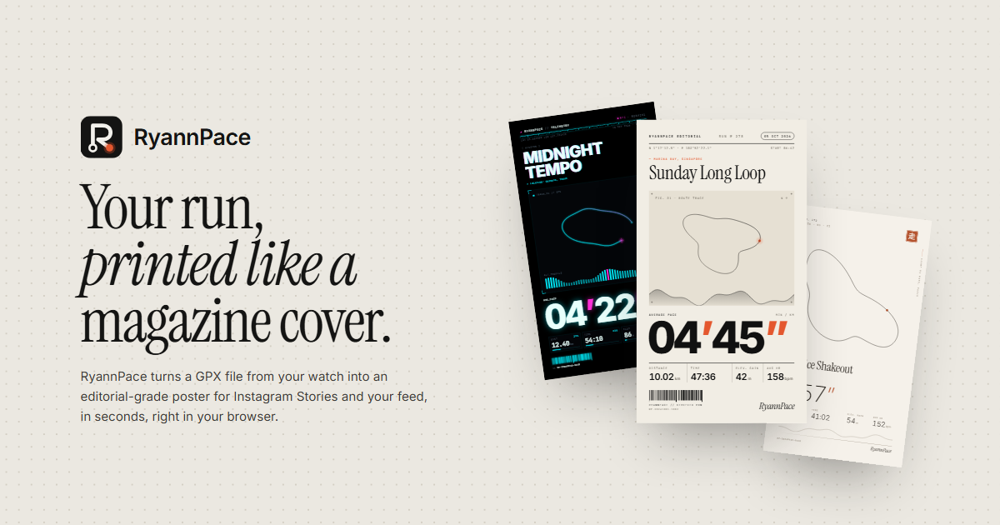

# RyannPace

**Turn your run into a magazine-cover poster.**
Drop in an activity file from your watch, pick a template and palette, and export an editorial-grade
poster for Instagram Stories or your feed, right in the browser.

**Live:** https://ryannpace.ryannpace-app.workers.dev/ · Part of [RyannSuite](https://ryannsuite.pages.dev)



## What it does

- Reads **GPX, FIT and TCX** files from Strava, Garmin, Coros, Suunto and Apple Watch, or imports
  straight from **Strava**.
- **Six templates** (Editorial, Cyberpunk, Minimal, Race Bib, Retro Mag, Stats Card), three formats
  (9:16, 4:5, 1:1) and 26 palettes, with a live preview.
- Exports a crisp **2160 × 3840 PNG**, a **"route draw" video** of the route drawing itself in, or
  shares straight from your phone.
- Free, no sign-up. Signing in only adds saved presets and a poster gallery.
- English and 中文. Installable as a PWA.

## How it's built

| Layer | Tech |
|---|---|
| App | Next.js 16 (App Router), React 19, TypeScript, Tailwind CSS 4, Zustand |
| API | Route handlers in `app/api/*` as a backend-for-frontend |
| Data & auth | Supabase (Postgres with row-level security, Google sign-in) |
| Hosting | Cloudflare Workers via OpenNext |
| Quality | Vitest unit tests, Playwright end-to-end tests, GitHub Actions CI with `npm audit` |

### Engineering notes

- **Activity files never leave the device.** GPX, FIT and TCX are parsed in the browser
  (`lib/activity-parsers.ts`, `lib/gpx-parser.ts`).
- **Routes keep their real shape.** GPS points are projected with an equirectangular projection
  scaled by cos(mid-latitude), so a route isn't stretched away from the equator
  (`lib/coordinate-normalizer.ts`).
- **Honest splits.** Per-km/mile splits use moving time only, so stopping at a traffic light
  doesn't create a fake slow split (`lib/splits.ts`).
- **Route-draw video.** The poster is rendered twice, once without the route and once complete,
  and each frame reveals the complete one through a mask that follows the route. Frames are encoded
  in the browser with Mediabunny (`lib/route-video.ts`).
- **Strava tokens never reach the browser.** They're encrypted with AES-GCM and kept in an httpOnly
  cookie; activities are fetched on demand and nothing from Strava is stored (`lib/strava.ts`).
- **Supabase keys are server-only.** The browser talks only to `app/api/*`; tables are protected by
  row-level security (`supabase/migrations/`).
- **Export size is tuned for phones.** Posters render at 2× (2160 px wide); 3× exceeds iOS Safari's
  canvas limit (`lib/export-engine.ts`).

## Run it locally

```bash
npm install
cp .env.example .env.local   # fill in your Supabase URL and anon key
npm run dev
```

Run the SQL files in `supabase/migrations/` in order in the Supabase SQL editor. Strava import,
Turnstile and analytics are optional; see `.env.example`.

| Command | What it does |
|---|---|
| `npm run dev` | Dev server |
| `npm run lint` / `npm run typecheck` | ESLint and TypeScript |
| `npm test` | Unit tests (Vitest) |
| `npm run test:e2e` | Browser tests (Playwright) |
| `npm run cf:preview` | Build for Cloudflare and run locally |
| `npm run cf:deploy` | Build and deploy to Cloudflare Workers |

## Project layout

```
app/          pages (studio, gallery, recap, privacy) and API route handlers (app/api)
components/   UI and poster templates
lib/          parsers, geometry, splits, export and video engines, Strava and Supabase helpers
store/        Zustand stores
supabase/     database migrations
tests/        unit and end-to-end tests
```

---

Built by [Bernard Ryan Sim](https://ryannsuite.pages.dev). © Bernard Ryan Sim. All rights reserved.
